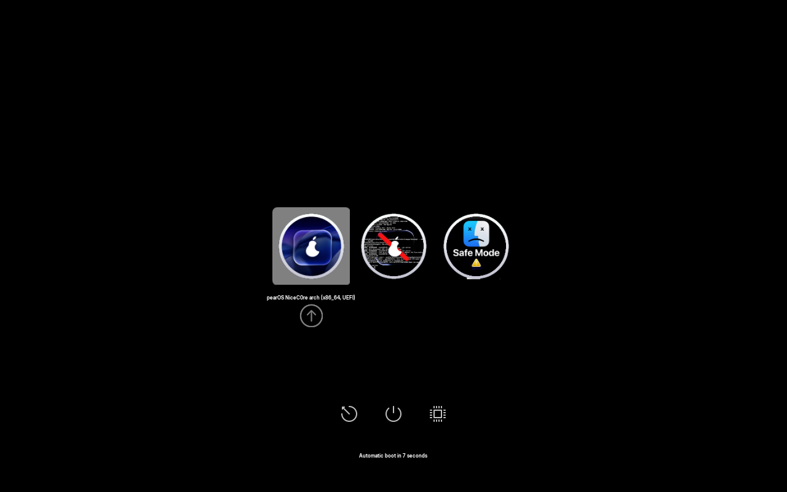
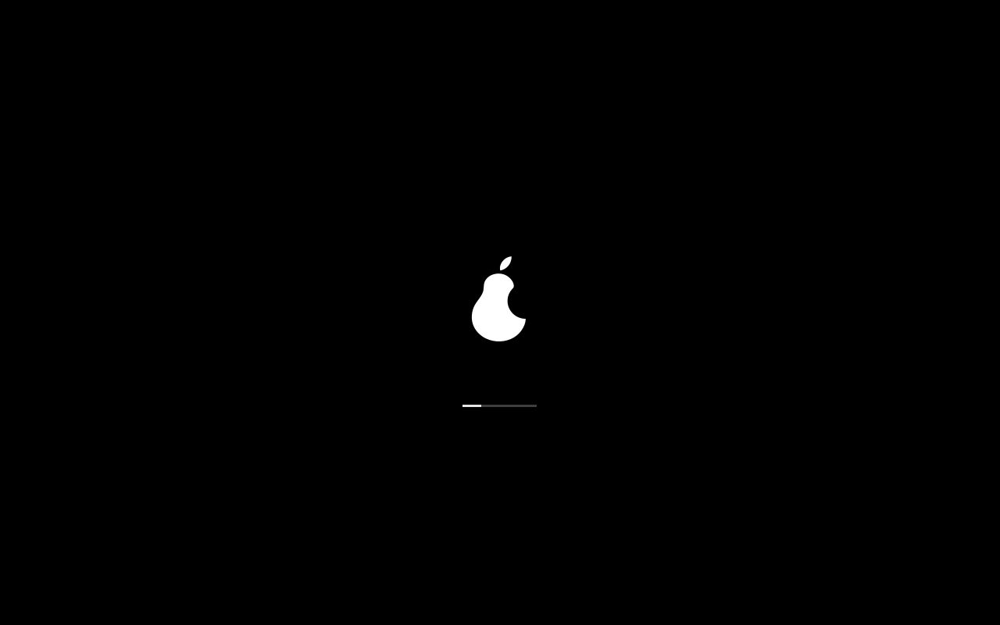
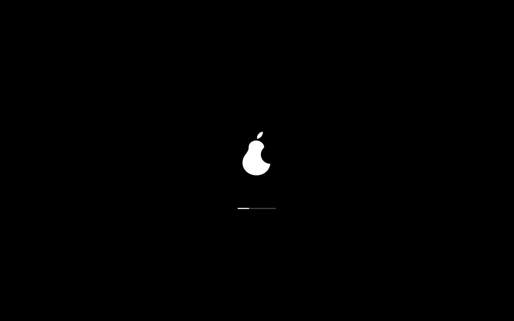
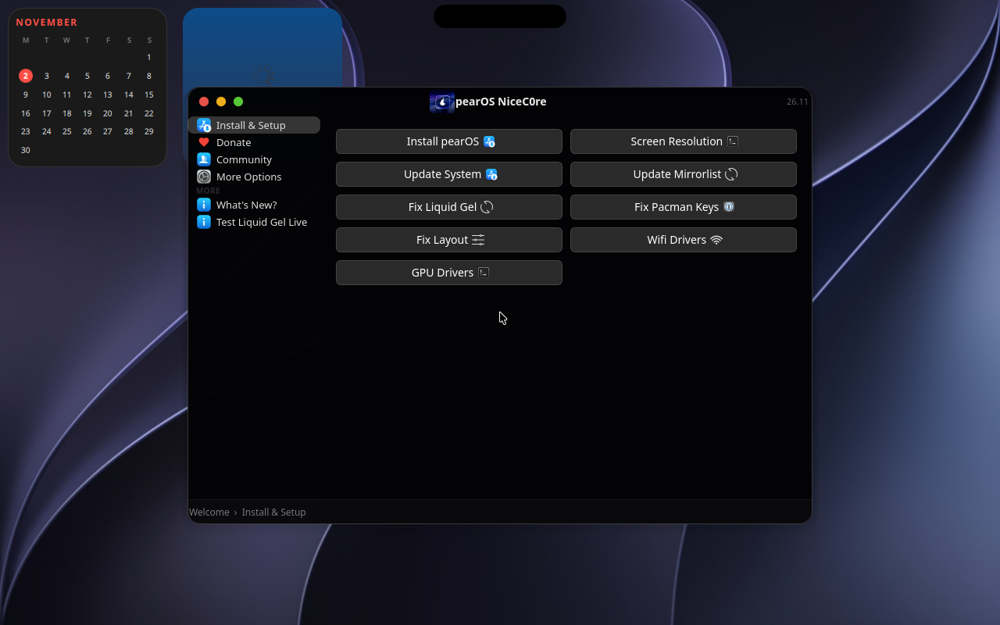
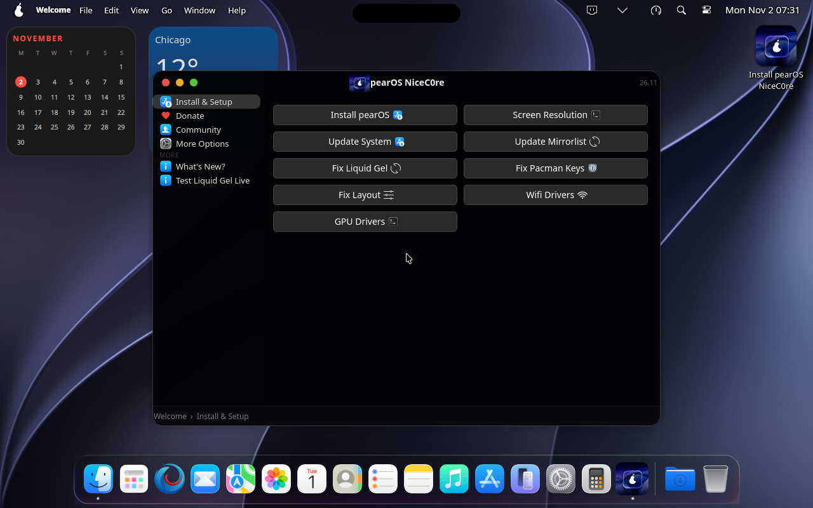
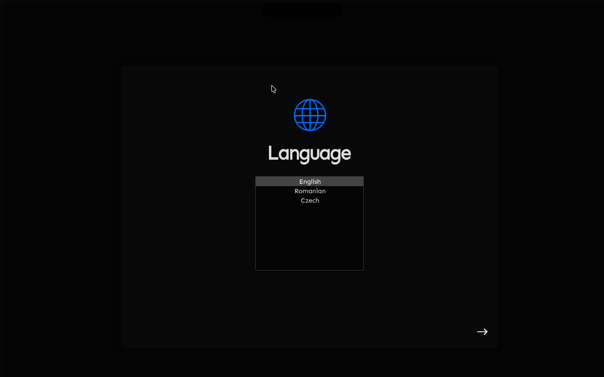
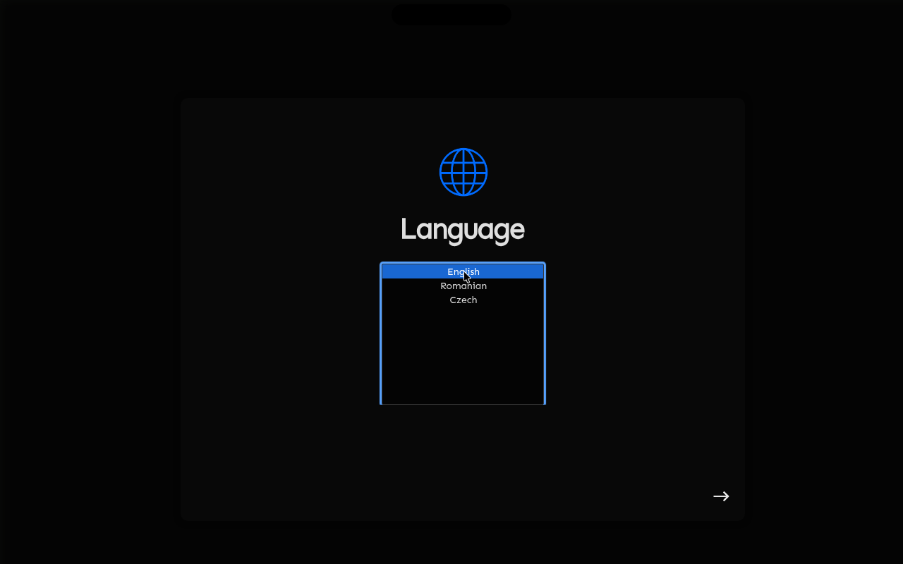
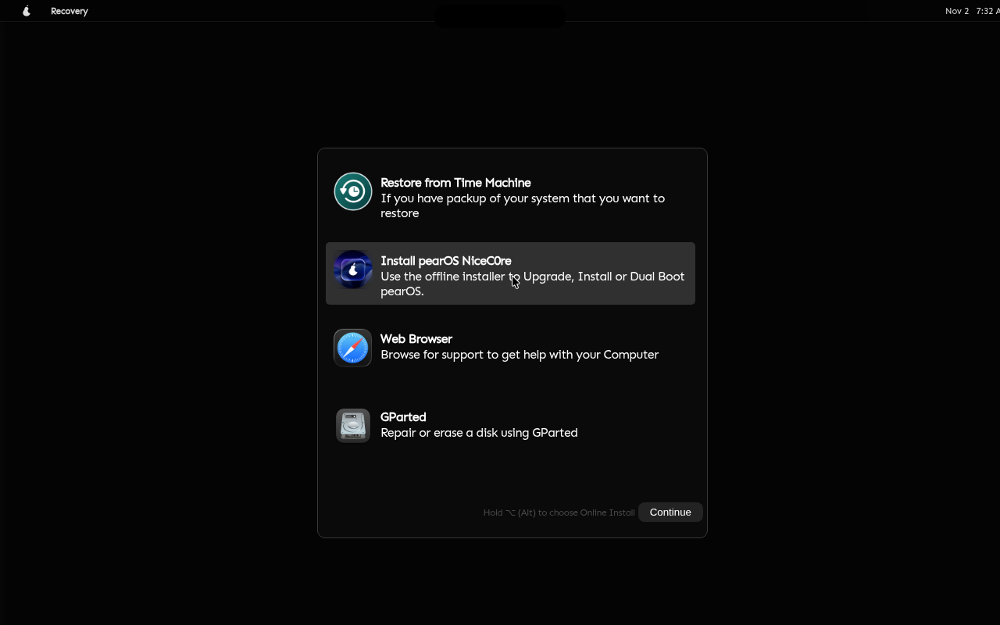
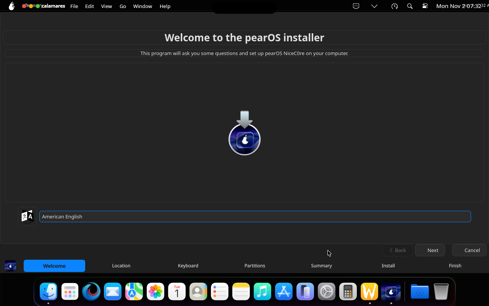
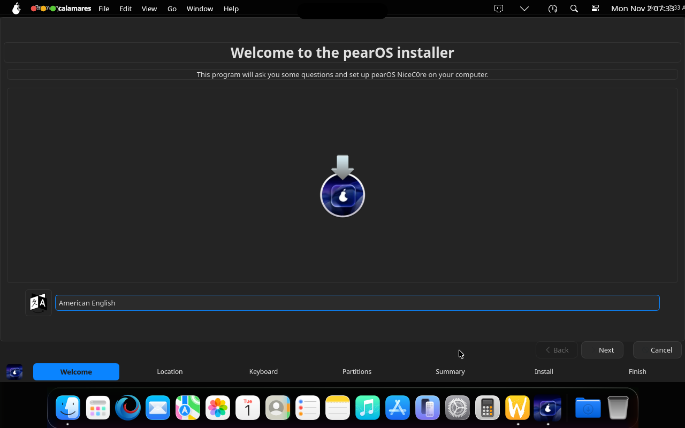

<div align='center'>
<p align="center">
  
  </p>


</a>

<a href="https://hits.sh/github.com/pearOS-archlinux/iso/"></a></a>

  <p><a href="https://discord.gg/QJPetvVhUb"> </a></p>
  
</div>

<br />

---


# pearOS-arch-base 📌
It is pearOS, but with Arch Base. Yes! It uses vanilla arch, less bugs, easier, better etc.

## Why? 📌
I had enough with Debian-based distros.
pearOS with an Arch base solves some of the big problems with pearOS, for example:

> "This requires you to reinstall with every new release"

> "`sudo apt upgrade` would/will destroy your installation"

Not anymore. With Arch, there's no more base-hopping.
Now, with Arch, the system is now Rolling Release, as it should be :>

You can do now `sudo pacman -Syu` and you will stil have the pearOS branding.

## Ok... How do I build it? 📌
Make sure you satisfy the dependencies in the section below.
After that, run `sudo ./build-binary` and ~~pray~~ wait.

**Note:** The build script must be run as root (using `sudo`) since it needs to create chroot environments and install packages.

### Dependencies: 📌

#### Required packages:
```sh
# Core build tools
sudo pacman -S arch-install-scripts    # Provides pacstrap and arch-chroot
sudo pacman -S mtools                  # Provides mcopy, mmd for FAT filesystem operations
sudo pacman -S squashfs-tools          # Provides mksquashfs for creating squashfs images
sudo pacman -S xorriso                 # Creates the final ISO image
sudo pacman -S e2fsprogs               # Provides mkfs.ext4 and tune2fs for filesystem creation
sudo pacman -S git                     # Required for cloning pearOS-installer during build
sudo pacman -S pv                      # Required to see progress bars
```

#### Optional packages:
```sh
# For EROFS image type support (if used in profiledef.sh)
sudo pacman -S erofs-utils             # Provides mkfs.erofs

# For GPG signing of the rootfs image (optional)
# GPG is usually pre-installed, but ensure it's available:
sudo pacman -S gnupg
```

#### Quick install command:
```sh
sudo pacman -S arch-install-scripts mtools squashfs-tools xorriso e2fsprogs git pv
```

#### Verify dependencies:
To check if all required commands are available, you can use:
```sh
command -v pacstrap arch-chroot mksquashfs xorriso mkfs.ext4 tune2fs git pv
```

If any command(s) are missing, install the corresponding package listed above.


[](https://ko-fi.com/W4V723UZ17)


## Updating Ploader (bootloader) 📌
The live ISO boots via **Ploader** (custom rEFInd fork, source at [pearOS-archlinux/pearos-bootloader](https://github.com/pearOS-archlinux/pearos-bootloader)) on UEFI, with syslinux kept as a BIOS/non-EFI fallback. `build-binary` does **not** compile Ploader itself — it just picks up prebuilt artifacts from `pear/efiboot/ploader/`. To update the bootloader:

```sh
git clone https://github.com/pearOS-archlinux/pearos-bootloader.git
cd pearos-bootloader
make
```

This needs the `gnu-efi` toolchain (`sudo pacman -S gnu-efi` on Arch). Once built, copy the artifacts into this repo:

```sh
cp pearos-bootloader/ploader/ploader_x64.efi   pear/efiboot/ploader/ploader_x64.efi
cp -r pearos-bootloader/theme                  pear/efiboot/ploader/theme
```

`pear/efiboot/ploader/` also holds two templates that `build-binary` sed-substitutes (`%ARCHISO_LABEL%`/`%INSTALL_DIR%`/`%ARCH%`) at build time and does **not** need regenerating unless boot options change:
- `ploader.conf` — sets `silent_menu false` so the picker is always shown on the live ISO (Ploader defaults to silent/seamless boot otherwise)
- `ploader_linux.conf` — the kernel auto-boot stanzas (FOSS/NVIDIA × Plymouth/no-Plymouth), Ploader's equivalent of a systemd-boot loader entry

`build-binary` validates all of the above exist before building and errors out clearly if `ploader_x64.efi` is missing.


## Boot Status sequence 📌
<!-- boot-seq:begin -->

Result: **booted, installer opened ✅**  
One screenshot every 10s.

1. `10s` — 
2. `20s` — 
3. `30s` — 
4. `40s` — 
5. `50s` — 
6. `60s` — 
7. `70s` — 
8. `80s` — 
9. `90s` — 
10. `100s` — 
11. `110s` — 
12. `120s` — 
13. `130s` — 
14. `140s` — 
15. `150s` — desktop ready, then clicked **Install pearOS** in Welcome — 
16. `160s` — pearOS installer loading — 
17. `170s` — Language screen, then selected English — 
18. `180s` — Language screen, then clicked Next — 
19. `190s` — Recovery screen, then selected **Install pearOS NiceC0re** (offline installer) — 
20. `200s` — Recovery screen, then clicked **Continue** — 
21. `210s` — 
22. `220s` — 
23. `230s` — 
24. `240s` — 
25. `250s` — 
26. `260s` — Calamares — 

<!-- boot-seq:end -->

## UI Sanity Test 📌
<!-- ui-sanity:begin -->

Result: **menu bar + dock look as expected ✅**  
Compared against the reference [`tests/ui-reference/desktop.png`](tests/ui-reference/desktop.png) (% of pixels within ±16 per channel; pass ≥ 90%).

| Area | Similarity |
|---|---|
| Top bar (first 30 px) | 96.9% |
| Dock (last 100 px) | 100.0% |

Current frame: 

<!-- ui-sanity:end -->

## Star History

<a href="https://www.star-history.com/?type=date&legend=top-left&repos=pearOS-archlinux%2Fiso">
 <picture>
   <source media="(prefers-color-scheme: dark)" srcset="https://api.star-history.com/chart?repos=pearOS-archlinux/iso&type=date&theme=dark&legend=top-left&sealed_token=KCoZpQtRPSEfeJaKHJdmS0_mY6Cv50bUn53rlA25Zk-xK6-KJNEOgL9vbIL9nE20I4mYm9HWHfmGXSqyM7W_TnimzH3sqXTzulsuHnp01jqHaj70KM4ElA" />
   <source media="(prefers-color-scheme: light)" srcset="https://api.star-history.com/chart?repos=pearOS-archlinux/iso&type=date&legend=top-left&sealed_token=KCoZpQtRPSEfeJaKHJdmS0_mY6Cv50bUn53rlA25Zk-xK6-KJNEOgL9vbIL9nE20I4mYm9HWHfmGXSqyM7W_TnimzH3sqXTzulsuHnp01jqHaj70KM4ElA" />
   
 </picture>
</a>

## Copyright and Licensing  📌
This project is released under the GNU Pubilc License v3 or later.

Copyright: Alexandru Balan @ Pear Software and Services S.R.L. based in Romania, Dacia Boulevard 133, floor D, Sector 2, Bucharest CIF: 50888207
